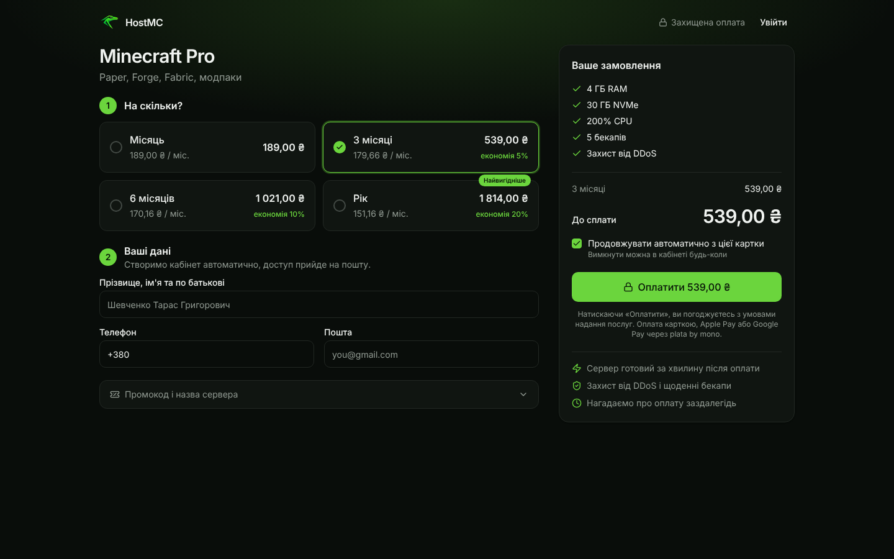
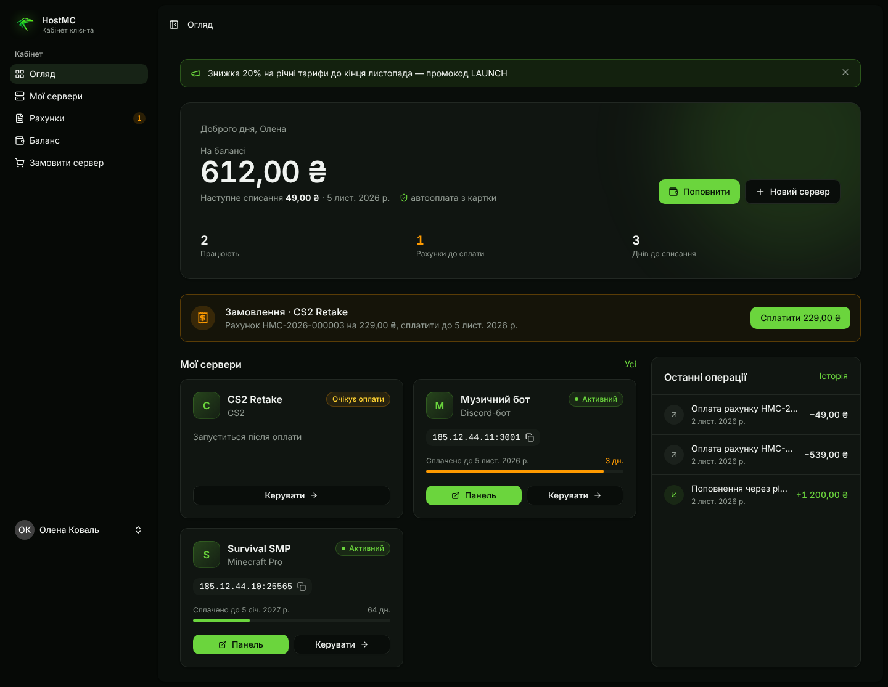
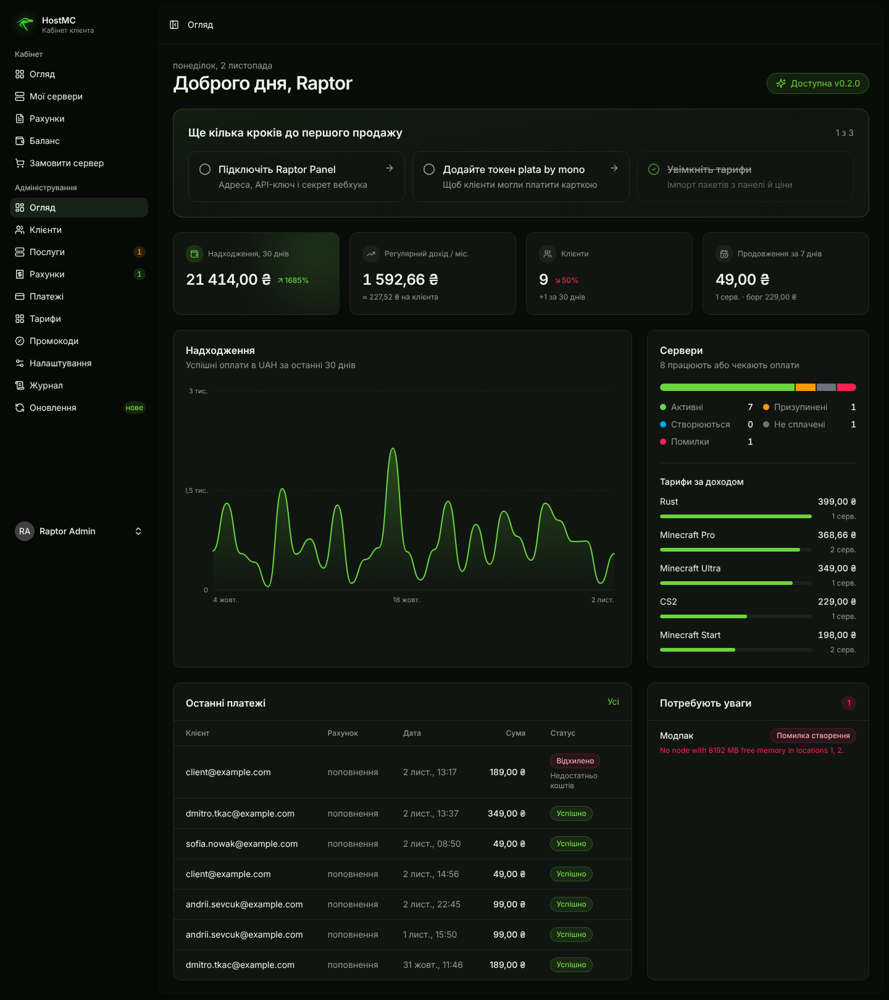

# Raptor Billing

Billing for game server hosting on [Raptor Panel](https://github.com/brocker96/raptor-panel). Customers pick a plan, pay with plata by mono, and the server appears in the panel by itself. After that, renewals, reminders, suspensions and deletions run on their own.

Laravel 13 + React (Inertia), the same stack as the panel. The interface is in Ukrainian.

| Checkout                           | Client area                         | Admin                           |
| ---------------------------------- | ----------------------------------- | ------------------------------- |
|  |  |  |

## What it does

- **Checkout from any website.** Link a "Buy" button straight to the payment page:
  `https://billing.example.com/checkout/minecraft-4gb?period=3`
  Optional `&promo=CODE` and `&currency=USD`. The visitor fills in full name, phone and email and presses one button. An account is created, the MonoPay page opens, and a "set your password" email arrives. In the admin area, under **Plans → Link**, the link is copied for you.
- **Balance + auto-renewal.** Every payment lands on the balance and invoices are paid from it. A saved card (MonoPay wallet) pays renewals automatically when the balance is short.
- **Automation (hourly):**
    - renewal invoice N days before the end of the period;
    - payment from balance or card;
    - suspension with a reason and a "pay" button shown in the panel;
    - deletion after N days;
    - abandoned orders cancelled after 7 days.
- **Panel integration** through the Raptor API:
    - provisioning with idempotency;
    - suspend / unsuspend / delete;
    - upgrade (prorated, applied immediately) and downgrade (from the next period);
    - one-click login into the panel;
    - live server load;
    - panel webhooks.
- **Admin:**
    - revenue and MRR;
    - clients and balance adjustments;
    - services with manual actions;
    - invoices (mark paid / cancel) and payments;
    - plans with prices per currency and period, plus import from panel packages;
    - promo codes;
    - settings with connection tests.
- **Activity log:** sign-ins, orders, payments, server changes and every admin action, with IP addresses.
- **Announcements:** a banner for every customer in the client area and the shop.
- Currencies: UAH, USD, EUR (one per customer).

## Install

One command on a clean Ubuntu 24.04 server, or next to Raptor Panel:

```bash
bash <(curl -fsSL https://raw.githubusercontent.com/brocker96/raptor-billing/main/install.sh)
```

It asks five questions (domain, hosting name, email, password, mono token) and sets up everything:
- PHP 8.3, MariaDB, Redis and nginx;
- the queue worker, the scheduler and HTTPS (Let's Encrypt);
- the first administrator.

When Raptor Panel runs on the same server, the billing connects to it by itself: an API key, a webhook, "Billing" links in the Panel menu, and plans imported from the Panel packages. Everything can also be passed as variables (`BILLING_FQDN`, `BILLING_EMAIL`, `BILLING_YES=1`, …), see the top of `install.sh`. Credentials are saved to `/root/raptor-billing-credentials.txt`.

<details><summary>Manual install</summary>

```bash
git clone https://github.com/brocker96/raptor-billing.git /var/www/billing && cd /var/www/billing
composer install --no-dev --optimize-autoloader
npm ci && npm run build
cp .env.example .env && php artisan key:generate   # set APP_URL, DB_*, MAIL_*
php artisan migrate --force
php artisan billing:admin you@example.com --name="You" --password="…"
```

Cron: `* * * * * php /var/www/billing/artisan schedule:run`. Queue worker: `php artisan queue:work`.
Point nginx at `public/`.
</details>

## Updates

**Admin → Оновлення** shows the installed version and the releases from GitHub with their notes. One button installs a release.

How an install works:
- a backup of the files and the database is made first;
- the archive is checked against its SHA-256 checksum;
- any failure restores the previous version automatically;
- progress and the log are shown live.

Other options:
- **Channels:** stable or beta.
- **Release checks:** hourly, with an email to the admins about a new version.
- **Optional night-time auto-install** for stable releases.
- **Rollback** to any of the last backups.

The same page has a **system health** board: cron, queue worker, automation, mail, disk, Raptor Panel and plata by mono.

From the command line: `php artisan billing:update` (also `--check`, `--backups`, `--rollback=latest`).

Releases are built by `.github/workflows/release.yml` when a `v*` tag is pushed. It attaches `billing.tar.gz` with its checksum, the release notes come from `CHANGELOG.md`, and the release is created as a draft to publish.

## Connect

Open **Admin → Settings**:

1. **Raptor Panel.**
    - In the panel go to Admin → Raptor API, create a key with `servers: write` and `users: write`. Paste the panel URL and the key, then press "Перевірити".
    - Add a panel webhook to the URL shown in the settings and paste its secret.
2. **plata by mono.** Get the token from web.monobank.ua → Settings → API (test token: api.monobank.ua). The MonoPay webhook URL is sent with every invoice, so nothing to configure there.
3. **Plans.** Click "Імпорт з панелі" to create plans from panel packages, set prices and turn them on.

Demo data for a first look: `php artisan db:seed --class=DemoSeeder` (admin@example.com / client@example.com, password `password`).

## Development

```bash
composer install && npm install
php artisan migrate --seed --seeder=DemoSeeder
composer run dev
php artisan test
```

## License

MIT.
